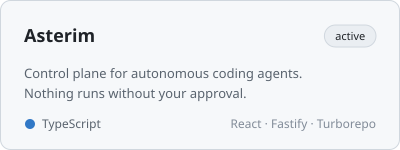
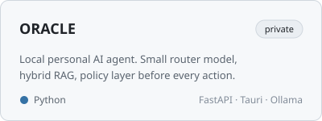
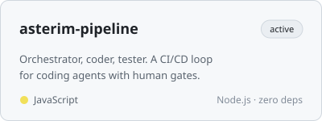
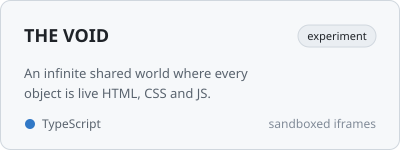
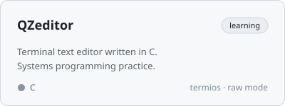
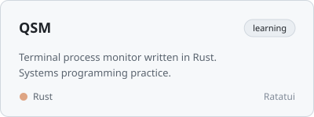

# qhukz

<picture>
  <source media="(prefers-color-scheme: dark)" srcset="https://readme-typing-svg.demolab.com?font=Fira+Code&weight=500&size=22&duration=3000&pause=1200&color=C9D1D9&center=true&vCenter=true&width=600&height=40&lines=Local-first+AI+dev+tooling;Agents%2C+RAG%2C+guardrails;Systems+programming;Learning+ML+from+scratch" />
  
</picture>

Ukraine &nbsp;·&nbsp; <a href="mailto:v.onashchuk@gmail.com">v.onashchuk@gmail.com</a>

 

## Stack

 

## Projects

<a href="https://github.com/qhukz13/Asterim"><picture><source media="(prefers-color-scheme: dark)" srcset="assets/projects/asterim-dark.svg" /></picture></a>
<picture><source media="(prefers-color-scheme: dark)" srcset="assets/projects/oracle-dark.svg" /></picture>
<a href="https://github.com/qhukz13/asterim-pipeline"><picture><source media="(prefers-color-scheme: dark)" srcset="assets/projects/asterim-pipeline-dark.svg" /></picture></a>
<a href="https://github.com/qhukz13/void"><picture><source media="(prefers-color-scheme: dark)" srcset="assets/projects/void-dark.svg" /></picture></a>
<a href="https://github.com/qhukz13/QZeditor"><picture><source media="(prefers-color-scheme: dark)" srcset="assets/projects/qzeditor-dark.svg" /></picture></a>
<a href="https://github.com/qhukz13/QSM"><picture><source media="(prefers-color-scheme: dark)" srcset="assets/projects/qsm-dark.svg" /></picture></a>

 

## Activity

<picture>
  <source media="(prefers-color-scheme: dark)" srcset="https://github-readme-stats.vercel.app/api?username=qhukz13&show_icons=true&theme=transparent&hide_border=true&title_color=c9d1d9&icon_color=8b949e&text_color=8b949e&rank_icon=github" />
  
</picture>
<picture>
  <source media="(prefers-color-scheme: dark)" srcset="https://github-readme-stats.vercel.app/api/top-langs/?username=qhukz13&layout=compact&theme=transparent&hide_border=true&title_color=c9d1d9&text_color=8b949e&langs_count=8&exclude_repo=SCRAPSHIFT" />
  
</picture>

<picture>
  <source media="(prefers-color-scheme: dark)" srcset="https://streak-stats.demolab.com/?user=qhukz13&theme=transparent&hide_border=true&ring=8b949e&fire=c9d1d9&currStreakLabel=c9d1d9&sideLabels=8b949e&currStreakNum=c9d1d9&sideNums=c9d1d9&dates=6e7681&stroke=30363d" />
  
</picture>

<picture>
  <source media="(prefers-color-scheme: dark)" srcset="https://github-readme-activity-graph.vercel.app/graph?username=qhukz13&bg_color=00000000&color=8b949e&line=c9d1d9&point=ffffff&area=true&area_color=8b949e&hide_border=true&title_color=c9d1d9" />
  
</picture>

<picture>
  <source media="(prefers-color-scheme: dark)" srcset="https://raw.githubusercontent.com/qhukz13/qhukz13/output/snake-dark.svg" />
  
</picture>

