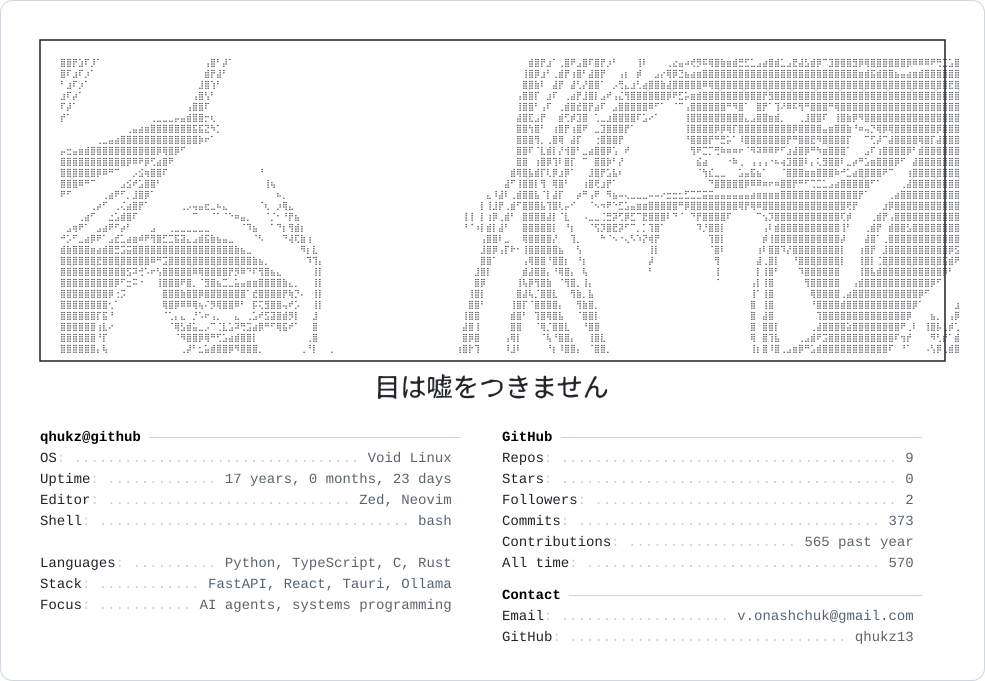

<a href="https://github.com/qhukz13">
  <picture>
    <source media="(prefers-color-scheme: dark)" srcset="fetch-dark.svg" />
    
  </picture>
</a>

  

 

<picture>
  <source media="(prefers-color-scheme: dark)" srcset="https://raw.githubusercontent.com/qhukz13/qhukz13/output/snake-dark.svg" />
  
</picture>

